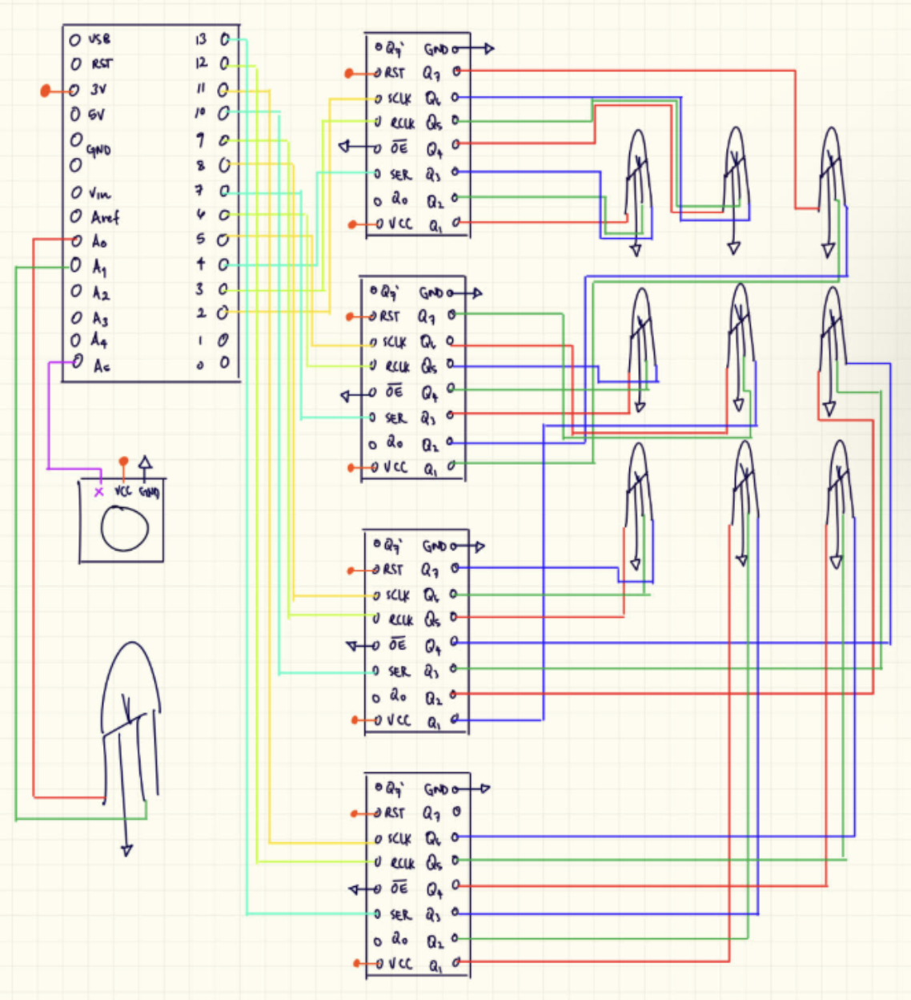
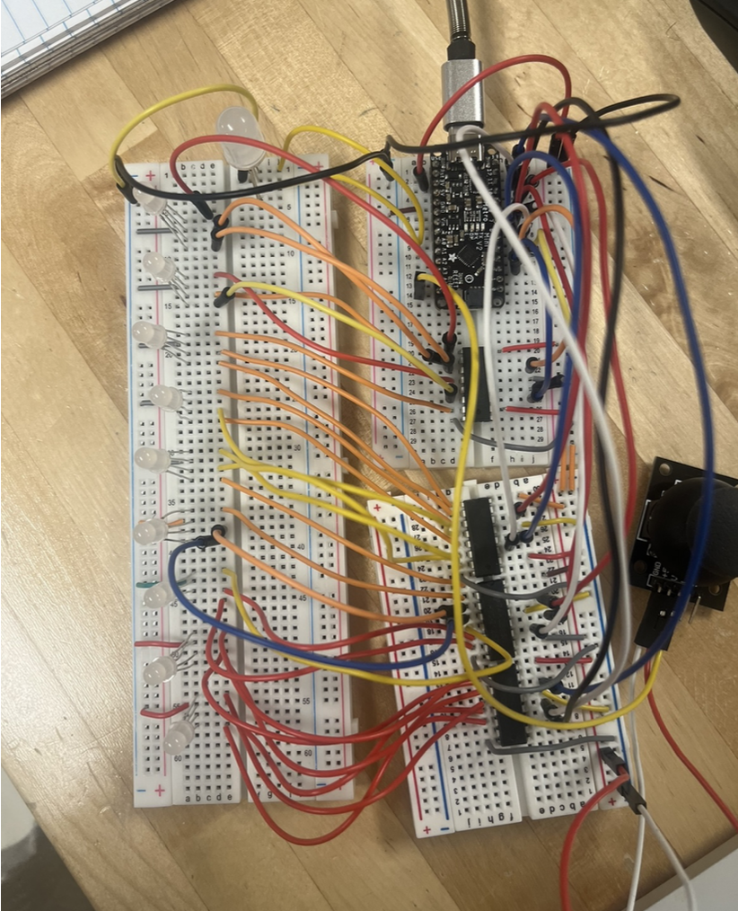
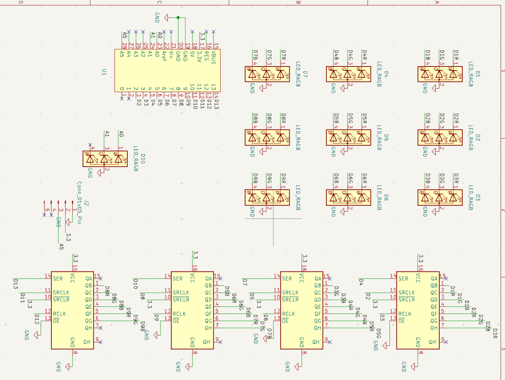
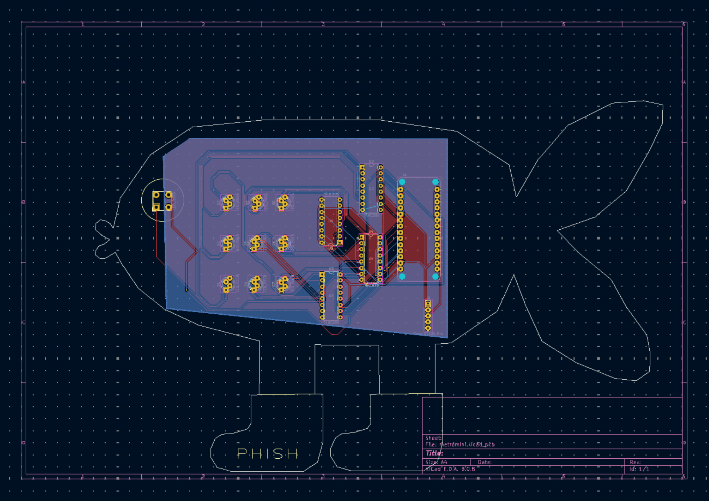
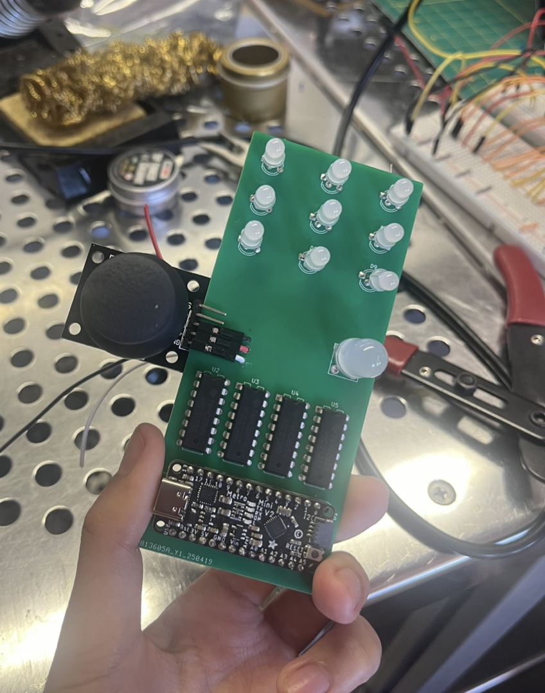
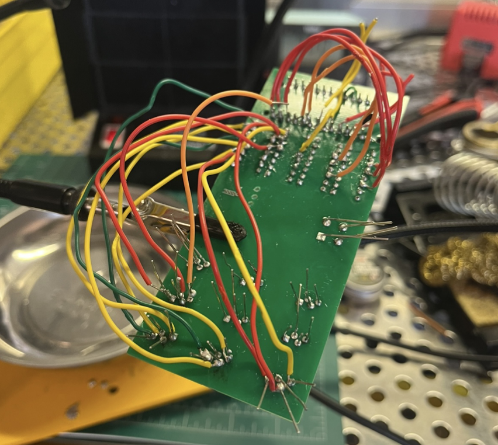
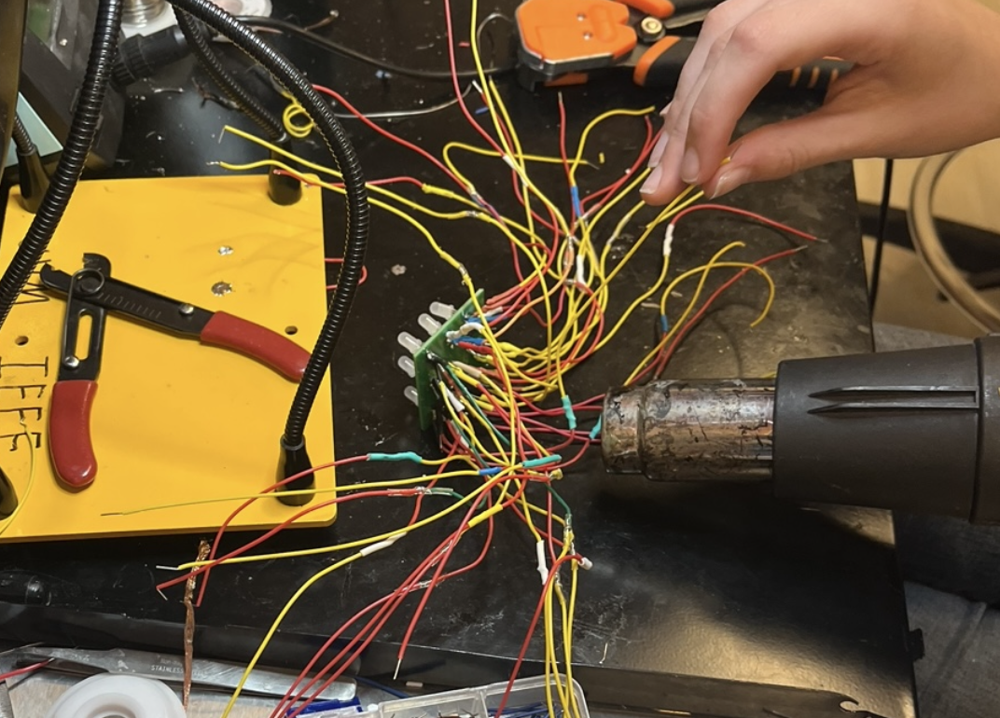
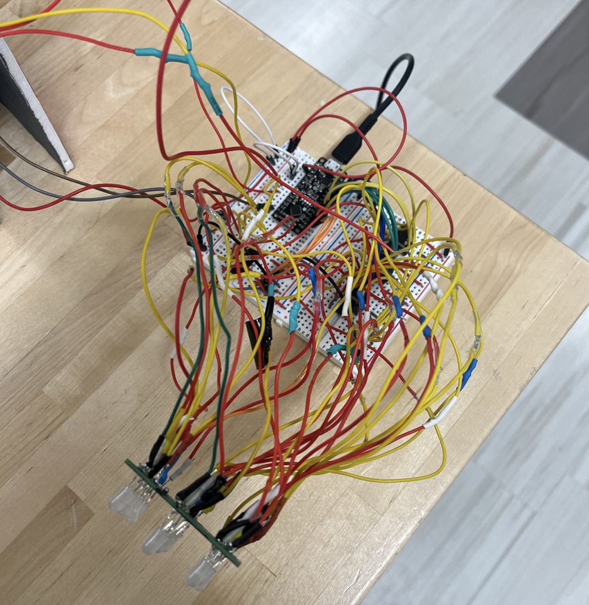
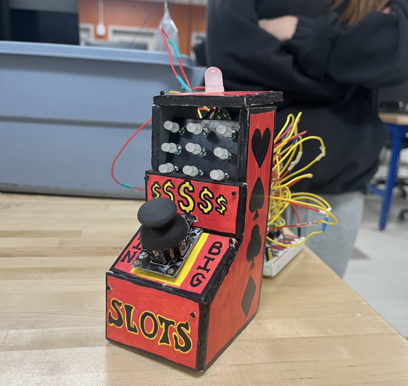
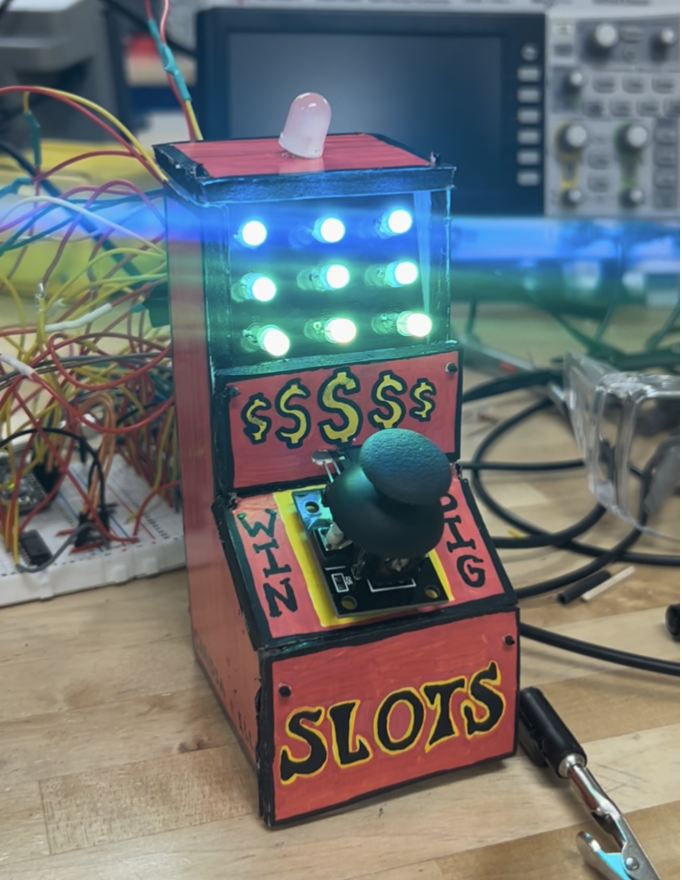

# Microcontroller-Based Slot Machine

PCB Design | Embedded Systems | KiCad | Digital Electronics | Circuit Design | Hardware Troubleshooting

## Project Overview

This project involved designing and building a microcontroller-based slot machine using RGB LEDs, shift registers, and a custom PCB. The goal was to recreate the basic functionality of a traditional slot machine, where a user pulls a lever to start the game, watches the display spin, and receives a clear indication of whether they won or lost.

The slot machine uses a 3×3 RGB LED matrix to simulate spinning reels, with a joystick serving as the lever. An Adafruit Metro Mini controls the display through four 74HC595 shift registers, which were needed to expand the number of available digital outputs.

A major part of this project was designing the PCB in KiCad and troubleshooting problems that came up during fabrication and assembly. Although the original board was not manufactured correctly, the project was completed using a combination of the fabricated PCB, soldered connections, and breadboard components.

## Project Objectives

- Design a functional slot machine with a physical user interface
- Create a 3×3 RGB LED display to simulate spinning reels
- Use shift registers to expand the microcontroller's digital output capabilities
- Develop code to control the LED patterns and determine winning combinations
- Design and fabricate a custom PCB using KiCad
- Assemble and troubleshoot the electrical system
- Test the completed device against the original project requirements

## Hardware

| Component | Function |
|---|---|
| Adafruit Metro Mini | Controls the game logic, reads joystick inputs, and communicates with the shift registers |
| 74HC595 Shift Registers (4) | Expand the number of digital outputs available to control the LEDs |
| RGB LEDs (9) | Form the 3×3 display used to simulate the slot machine reels |
| Additional RGB LED | Indicates whether the player won or lost |
| Joystick (B103 348) | Acts as the lever used to start the game |
| Custom PCB | Provides mounting locations and electrical connections for the components |
| Resistors | Limit current through the LEDs |
| Breadboard and Jumper Wires | Used during initial testing and in the final modified assembly |
| Soldered Wire Connections | Replace missing PCB traces and connect components |
| USB Connection | Supplies power to the microcontroller |

## System Architecture

The slot machine follows a relatively simple sequence, although controlling the individual LEDs required more involved circuitry and programming.

1. **User Input:** The player moves the joystick to start the game.
2. **Input Detection:** The Metro Mini reads the joystick's analog position and begins the game once a threshold is reached.
3. **LED Control:** The microcontroller sends serial data to the shift registers, which control the individual RGB LED channels.
4. **Reel Animation:** The LED columns cycle through different colors before stopping at randomized positions.
5. **Win Detection:** The program compares the final colors of the three LEDs in the bottom row.
6. **Game Response:** A separate LED indicates the outcome, and the system resets for another round.

## Circuit Design

One of the first challenges was determining how to control all the LEDs with the available microcontroller pins.

The slot machine uses ten RGB LEDs, each requiring three control signals for its red, green, and blue channels. This resulted in 30 LED control connections, which exceeded the available digital outputs on the Metro Mini.

To solve this, four 74HC595 shift registers were used. Each register provides eight parallel outputs, allowing multiple LED channels to be controlled using serial data from the microcontroller.

The circuit was initially developed and tested on a breadboard before moving into PCB design. This made it possible to verify the LED connections, shift register communication, and overall functionality before committing to a permanent layout.

## Software Implementation

The program was written in C/C++ using the Arduino IDE. The main programming challenge was controlling the LED display while keeping track of the final colors for win detection.

### Joystick Input

The joystick's X-axis was used as the game lever. The microcontroller continuously monitored its analog value, and when the reading exceeded a threshold of 700, the game sequence began.

This prevented the game from starting until the player intentionally moved the joystick.

### Shift Register Control

The RGB LEDs were controlled using the Arduino `shiftOut()` function. Binary values were sent to the shift registers to determine which LED channels should be turned on.

Each color was represented by a combination of red, green, and blue outputs. For example, activating both red and blue channels produced purple.

The program controlled the latch pins to update the shift register outputs after the new data had been transmitted.

### Reel Animation and Randomization

Once the game started, the LED columns cycled through different color patterns to simulate spinning reels.

Randomized stopping points were generated for each column, allowing the reels to stop at different positions during each round. The final LED states were stored as binary values so they could later be compared.

### Win Detection

After all three columns stopped, the program checked the colors of the three LEDs in the bottom row.

Bitwise operations were used to isolate the relevant bits from the stored LED data. These values were then compared to determine whether all three LEDs displayed the same color.

- **Win:** The indicator LED flashes green and remains green for 10 seconds.
- **Loss:** The indicator LED turns red for 5 seconds.
- **Reset:** The LEDs turn off, and the game becomes ready for another round.

**Programming Language:** C/C++  
**Microcontroller:** Adafruit Metro Mini  
**Development Environment:** Arduino IDE  
**Main Programming Concepts:** Serial communication, bitwise operations, randomization, analog input, and shift register control

## PCB Design and Development

The PCB was designed independently in KiCad using the working breadboard circuit as a reference.

The first step was recreating the circuit as a schematic. Because of the large number of connections between the microcontroller, shift registers, and LEDs, net labels were used to keep the schematic organized and easier to follow.

A custom schematic symbol and footprint were also created for the Adafruit Metro Mini. The footprint dimensions and pin locations were measured directly from the physical board to ensure the microcontroller would fit correctly.

Once the schematic was completed, the components were arranged in the PCB editor and the layout was prepared for fabrication. Gerber and drill files were generated and submitted to JLCPCB.

### PCB Fabrication Error

The first fabricated PCB arrived without copper traces connecting the components. Although the component footprints and through-holes were correctly positioned, the traces had not been routed in KiCad before the manufacturing files were generated.

The schematic and PCB layout were corrected afterward, but due to the cost and shipping time associated with ordering another board, the original PCB was used for the physical prototype.

This created a much larger troubleshooting task than initially expected, since the missing connections had to be made manually.

## Testing and Troubleshooting

### Replacing Missing PCB Traces

The initial plan was to recreate the missing copper traces using soldered wires on the back of the PCB.

However, the design required more than 70 individual connections. Routing that many wires in a confined area became difficult, particularly where connections crossed or ran close to one another. Several attempts resulted in shorts between conductive sections.

After troubleshooting these issues, it became clear that recreating the entire PCB routing manually was not the most practical solution.

The design was adapted into a hybrid assembly using the fabricated PCB, additional soldered wiring, and breadboard connections. This allowed the existing board to be used without requiring every missing trace to be recreated directly on the PCB.

Heat-shrink tubing was also used to insulate exposed wire connections and reduce the risk of accidental shorts.

### Functional Testing

The completed device was tested against the original breadboard prototype to confirm that the modified assembly maintained the intended functionality.

Testing focused on:
- Joystick activation and game initialization
- LED color output and shift register communication
- Reel animation and randomized stopping positions
- Correct detection of winning and losing combinations
- Reliability of the modified electrical connections
- Visibility of the win/loss indicator

Despite the PCB fabrication problems, the final device was able to perform the intended slot machine functions.

## Project Media

### Initial Circuit Design and Prototyping

  
  

  <em>Figure 1. Initial circuit schematic (left) and breadboard prototype (right), used to test the electrical connections before PCB development.</em>

### PCB Schematic

  

  <em>Figure 2. PCB schematic created in KiCad, showing the electrical connections between the microcontroller, shift registers, RGB LEDs, and supporting components.</em>

### PCB Layout

  

  <em>Figure 3. Custom PCB layout designed in KiCad, including component placement, footprints, and copper trace routing.</em>

### PCB Assembly and Soldering

  
  

  <em>Figure 3. Soldered PCB components (left) and additional wire connections made during troubleshooting (right).</em>

### Wiring and Final Assembly

  
  

  <em>Figure 4. Heat-shrink insulation applied to electrical connections (left) and assembled device with soldered components (right).</em>

### Completed Slot Machine

  
  

  <em>Figure 5. Completed slot machine with the LEDs powered off (left) and powered on (right).</em>

## Future Improvements

The main improvement would be fabricating and assembling the corrected PCB with properly routed copper traces. This would eliminate much of the additional wiring used in the final prototype and make the electrical system more compact and reliable.

A correctly fabricated board would also simplify assembly and make troubleshooting easier, since connections could be traced directly through the PCB layout.

Another possible improvement would be adding a speaker to provide sound effects during the reel animation and indicate whether the player won or lost.

## Project Information

**Course:** Circuits Design Project (EE2185)

**Institution:** University of Vermont

**Project Type:** Team Project

**Team Members:** Carissa Lee and Ella Stephani

**Contributions:** Independently designed the PCB in KiCad, including schematic capture, custom component symbols and footprints, PCB layout, and manufacturing file preparation. Collaborated on programming the 74HC595 shift registers and LED control logic, as well as circuit assembly, testing, and troubleshooting. Worked on modifying the fabricated PCB after discovering the missing copper traces and integrating the additional wiring needed to complete the device.
